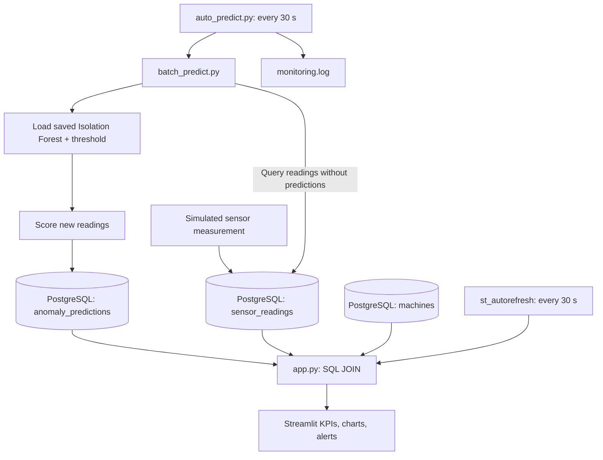

# Industrial Machine Monitoring & Anomaly Detection

**An end-to-end, polling-based industrial equipment monitoring prototype built with Python, PostgreSQL, scikit-learn, and Streamlit.**

> **Project status:** Working local educational prototype using **synthetic** sensor data. This project demonstrates an ML-enabled monitoring workflow; it is **not** a production deployment, a validated industrial fault detector, or a remaining-useful-life predictor.

## Table of contents

1. [What this project does](#1-what-this-project-does)
2. [Architecture and end-to-end data flow](#2-architecture-and-end-to-end-data-flow)
3. [Project files and responsibilities](#3-project-files-and-responsibilities)
4. [Database design](#4-database-design)
5. [Synthetic sensor data](#5-synthetic-sensor-data)
6. [Machine learning workflow](#6-machine-learning-workflow)
7. [Model evaluation and interpretation](#7-model-evaluation-and-interpretation)
8. [How predictions reach the dashboard](#8-how-predictions-reach-the-dashboard)
9. [Dashboard behavior](#9-dashboard-behavior)
10. [Logging and failure handling](#10-logging-and-failure-handling)
11. [Installation and local setup](#11-installation-and-local-setup)
12. [Runbook: start, test, and stop](#12-runbook-start-test-and-stop)
13. [SQL examples and useful checks](#13-sql-examples-and-useful-checks)
14. [Troubleshooting](#14-troubleshooting)
15. [Design decisions and lessons learned](#15-design-decisions-and-lessons-learned)
16. [Known limitations and next steps](#16-known-limitations-and-next-steps)
17. [Repository publishing checklist](#17-repository-publishing-checklist)

---

## 1. What this project does

Industrial machines can produce repeated measurements such as motor temperature, vibration, electrical current, and rotational speed. This prototype demonstrates how to turn such measurements into a queryable history and an operator-facing monitoring interface.

The workflow has **two distinct parts**:

- **Offline model development:** generate labeled synthetic data, train an unsupervised Isolation Forest, evaluate score thresholds, and save the fitted model.
- **Local operational demonstration:** insert sensor readings into PostgreSQL, periodically score previously unprocessed records, store predictions, and refresh a Streamlit dashboard.

The application currently supports multiple machines in the database, although the saved model is a **shared generic synthetic-data model**, not a calibrated model for each machine type.

### What the system does *not* claim

An `ANOMALY` means the model found a measurement combination unusual relative to its training distribution and chosen threshold. It does **not** prove a component is broken. There is no PLC/SCADA connection, live sensor stream, root-cause diagnosis, maintenance recommendation, or industrial validation in the current implementation.

## 2. Architecture and end-to-end data flow



### The actual sequence when a new row is inserted

1. A test operator inserts a new measurement into `sensor_readings`. **The existing project does not automatically ingest physical sensor data**; test readings have been inserted manually with SQL.
2. `auto_predict.py` wakes on its next **30-second polling cycle** and launches `batch_predict.py` in a child Python process.
3. `batch_predict.py` queries `sensor_readings` for rows whose `reading_id` does **not** already appear in `anomaly_predictions`.
4. It loads `industrial_anomaly_model.joblib`, selects the four input columns **in the training feature order**, calculates Isolation Forest scores, and classifies each row using the saved threshold.
5. It writes `anomaly_score`, `threshold`, and `predicted_status` to `anomaly_predictions`, linked by `reading_id`.
6. Separately, Streamlit refreshes roughly every **30 seconds**, executes a SQL join, and redraws the selected machine's KPIs, plots, and alert table.
7. The new row becomes visible **after both prediction and dashboard refresh have occurred**, provided the selected machine and time range include it.

**Timing is not instantaneous.** Two independent 30-second polling loops can produce roughly 0–60 seconds of scheduling delay under normal conditions, plus query, model execution, and browser overhead. Actual timing can be longer if a worker fails, the browser session is paused, or the application is stopped. This is **polling**, not push-based streaming.

### Separation of responsibilities

- **PostgreSQL** stores observations and predictions persistently.
- **Isolation Forest** evaluates measurement patterns; it does not communicate with Streamlit directly.
- **The worker** executes the model and persists results.
- **Streamlit** reads stored results; it does not train or execute the model when the page refreshes.
- **The synthetic CSV** is for offline model experiments and is separate from the small manually populated database used in the dashboard demonstration.

## 3. Project files and responsibilities

The descriptions below are based on the actual uploaded Python files, not filenames alone.

| File | Purpose | Inputs | Outputs / side effects | When to run |
|---|---|---|---|---|
| `generate_sensor_data.py` | Creates reproducible simulated operating data and injected anomalies | NumPy RNG seed 42 | `synthetic_sensor_data.csv` | When rebuilding the offline dataset |
| `train_anomaly_model.py` | **Early exploratory** Isolation Forest training and visualization; evaluates on the same dataset used for fitting | Synthetic CSV | Console metrics and Matplotlib chart | For learning/illustration, **not** as final model validation |
| `evaluate_new_data.py` | Demonstrates chronological splitting and scoring a later test segment | Synthetic CSV | Console confusion matrix/report | For offline evaluation; not the artifact-writing script |
| `validate_threshold.py` | Trains on normal rows from the first 600 observations, compares thresholds on validation data, evaluates a later test segment, and **saves the model package** | Synthetic CSV | `industrial_anomaly_model.joblib`, metrics | When intentionally retraining/replacing the saved model |
| `predict_machine_status.py` | Scores one manually defined four-feature example without using PostgreSQL | Saved joblib model | Console score/status | Quick model smoke test |
| `predict_from_database.py` | Scores **the latest** record for machine ID 1 and inserts a prediction | PostgreSQL + joblib | One possible `anomaly_predictions` row | Optional manual database demonstration |
| `batch_predict.py` | Finds **all** sensor records without predictions, scores them in a batch, inserts results | PostgreSQL + joblib | New prediction rows, console summary | Manually or through the worker |
| `auto_predict.py` | Runs the batch script repeatedly every 30 seconds and logs execution outcomes | `batch_predict.py` | `monitoring.log`; new predictions via child script | Keep running for automated polling |
| `machine_dashboard.py` | Produces a **static Matplotlib** monitoring view for machine ID 1 | PostgreSQL predictions and sensor data | Desktop chart | Optional analysis/earlier dashboard prototype |
| `app.py` | Runs the **interactive Streamlit** dashboard, machine selection, time filters, charts, KPIs, and alerts | PostgreSQL tables | Browser interface | Keep running for the monitoring UI |
| `analyze_downtime.py` | Separate introductory analysis of machine downtime, stop counts, and illustrative availability | `downtime_events`, `machines` | Console summaries and bar chart | Optional operations analysis; not part of the anomaly worker |
| `requirements.txt` | Lists direct Python package dependencies | — | Reproducible installation target | Install once in a new virtual environment |
| `.gitignore` | Prevents common local/generated files from being newly tracked | — | Git exclusions | Keep in repository |
| `README.md` | Explains the system and how to run it | — | Project documentation | Read first |

### Important relationships

`generate_sensor_data.py` → `synthetic_sensor_data.csv` → `validate_threshold.py` → `industrial_anomaly_model.joblib`

`PostgreSQL sensor_readings` → `batch_predict.py` (called by `auto_predict.py`) → `PostgreSQL anomaly_predictions` → `app.py`

**These paths are related, but not identical.** Training data is in a CSV; demonstration monitoring readings are in PostgreSQL. The code does not automatically import the training CSV into the operational database.

## 4. Database design

The current PostgreSQL database is named **`industrial_monitoring`**. It was renamed from a company-specific learning name to keep the portfolio generic. The Python connection URLs in the uploaded files use:

```python
create_engine("postgresql+psycopg://localhost:5432/industrial_monitoring")
```

This assumes a locally running PostgreSQL server on port 5432 and an account that can authenticate using local defaults. The database name is currently **hardcoded in several scripts**; centralizing configuration in environment variables is a recommended improvement.

### Main tables

**`machines`**: equipment inventory, with `machine_id` as the primary key, plus name, type, installation date, and active flag.

**`sensor_readings`**: one row per observation. Key fields:

| Column | Meaning |
|---|---|
| `reading_id` | Unique observation identifier; primary key |
| `machine_id` | Foreign key to `machines` |
| `recorded_at` | Measurement timestamp |
| `temperature_c` | Temperature in °C |
| `vibration_mm_s` | Vibration measurement in mm/s |
| `motor_current_a` | Motor current in amperes |
| `speed_rpm` | Rotational speed in RPM |

**`anomaly_predictions`**: model output linked to a specific reading:

| Column | Meaning |
|---|---|
| `prediction_id` | Unique prediction row |
| `reading_id` | Foreign key to `sensor_readings`; also unique in the current local schema |
| `anomaly_score` | Raw `IsolationForest.score_samples` result |
| `threshold` | Decision cutoff used for that stored prediction |
| `predicted_status` | `NORMAL` or `ANOMALY` |
| `predicted_at` | Database insertion timestamp |

The learning project also created `downtime_events` and `machine_operations` for introductory SQL and equipment-availability exercises. Those tables are **not inputs to the current anomaly model**.

### Why primary keys, foreign keys, and a unique constraint matter

- `machine_id` links each reading to the correct machine.
- `reading_id` links the prediction back to the **exact** sensor record.
- A unique constraint on `anomaly_predictions.reading_id` prevents two saved prediction rows for the same observation.
- The insert statement uses `ON CONFLICT (reading_id) DO NOTHING` so a repeated run does not create duplicate predictions.
- `engine.begin()` provides a database transaction for the inserts.

**Important limitation:** The current design intentionally stores **one prediction per reading**. If the model is retrained, old predictions are not automatically recalculated. For production experiments, introduce a `model_version` and an explicit rescore strategy.

### Join used by the dashboard

```sql
SELECT
    s.recorded_at,
    s.temperature_c,
    s.vibration_mm_s,
    p.predicted_status
FROM sensor_readings AS s
JOIN anomaly_predictions AS p
    ON s.reading_id = p.reading_id
WHERE s.machine_id = :machine_id
ORDER BY s.recorded_at, s.reading_id;
```

The Python code executes this with SQLAlchemy's `text(query)` and `params={"machine_id": int(selected_machine)}`. `text()` is important because SQLAlchemy interprets `:machine_id` as a **bound parameter**, not as literal PostgreSQL syntax. This is safer and more reliable than building a SQL string with user input.

Because the query uses an **INNER JOIN**, a newly inserted sensor reading will **not** appear in the dashboard until a prediction exists for it. The UI is therefore a view of **scored readings**, not all raw incoming readings.

## 5. Synthetic sensor data

`generate_sensor_data.py` produces **1,000** one-minute observations starting at `2026-10-01 08:00:00`, using NumPy's `default_rng(42)` for reproducibility.

The nominal distributions in the generator are:

| Feature | Simulated normal distribution |
|---|---|
| Temperature | Normal(mean 45 °C, standard deviation 3 °C) |
| Vibration | Normal(mean 2.0 mm/s, standard deviation 0.3 mm/s) |
| Motor current | Normal(mean 12 A, standard deviation 1 A) |
| Speed | Normal(mean 1450 RPM, standard deviation 20 RPM) |

The script selects **50 distinct rows** and injects an artificial abnormal pattern: temperature **+20 °C**, vibration **+3 mm/s**, current **+5 A**, and speed **−150 RPM**. It sets `simulated_anomaly = 1` for those rows and `0` for the others.

The label is **known because we generated it**. It is used for evaluation; the unsupervised Isolation Forest does not receive the label as an input feature.

This setup is deliberately simple. The four signals are generated independently in the normal regime, anomalies are strong and coordinated, and there is no sensor noise model, operating mode, drift, seasonal behavior, maintenance intervention, or physical machine dynamics. Results should not be extrapolated to real factories.

## 6. Machine learning workflow

### 6.1 Input features

The saved model expects **exactly these columns in this order**:

```python
features = [
    "temperature_c",
    "vibration_mm_s",
    "motor_current_a",
    "speed_rpm",
]
```

The feature list is stored in the joblib package and reused by both the manual and database prediction scripts. This prevents accidental changes in input column order between training and inference.

### 6.2 Why Isolation Forest?

Isolation Forest is an unsupervised anomaly detection algorithm. It constructs randomized decision trees that tend to isolate unusual observations with shorter paths. It is a useful **baseline** when real failure labels are scarce, but it does not identify specific fault types or predict failures.

The final artifact-writing workflow in `validate_threshold.py` uses:

```python
model = IsolationForest(
    n_estimators=100,
    contamination="auto",
    random_state=42,
)
```

The code fits on the **normal-labeled subset of the first 600 chronologically ordered synthetic observations**. Filtering to normal records is possible here only because the data is simulated and labeled. A real unlabeled industrial dataset would require a different training-data quality strategy.

### 6.3 Chronological split

The 1,000 observations are split by row order:

| Segment | Rows | Purpose |
|---|---:|---|
| Train | 0–599 | Fit the model, after filtering simulated anomalies |
| Validation | 600–799 | Compare score thresholds |
| Test | 800–999 | Report later-segment performance |

Chronological splitting is preferable to randomly mixing future observations into training for this time-ordered demonstration. It does not, by itself, establish robust temporal generalization.

### 6.4 Why use `score_samples` instead of just `predict`?

`IsolationForest.predict()` returns `1` or `-1` based on the estimator's internal decision threshold. The project instead uses the continuous score:

```python
score = model.score_samples(X)
status = "ANOMALY" if score < threshold else "NORMAL"
```

**Lower scores are more anomalous.** Using an explicit threshold makes the operational decision rule inspectable and allows threshold comparison on a validation set.

### 6.5 Threshold selection

`validate_threshold.py` calculates score cutoffs at the **1st, 3rd, and 5th percentiles of normal training scores**, then compares validation precision, recall, and F1.

The selected threshold in the learning run was approximately **−0.612429** (1st percentile). The saved package contains:

```python
{
    "model": fitted_isolation_forest,
    "threshold": selected_float_threshold,
    "features": ordered_feature_list,
}
```

`joblib` serializes Python objects. **Only load model files you trust**; loading an untrusted joblib/pickle file can execute code.

### 6.6 Why are there three training/evaluation scripts?

The project evolved during learning:

- `train_anomaly_model.py` was the first experiment. It trains and evaluates on the **same full dataset**, so its metrics are optimistic and **not suitable as an independent test estimate**.
- `evaluate_new_data.py` introduced chronological train/test separation and a training-score-based cutoff. Its code contains a duplicated normal-data filtering statement, which is harmless but can be cleaned up.
- `validate_threshold.py` added a validation comparison, selected the threshold, evaluated the later segment, and **wrote the model package** consumed by inference scripts.

**Operational scripts load the artifact produced by `validate_threshold.py`, not a model created by `train_anomaly_model.py`.**

## 7. Model evaluation and interpretation

During the learning run, the selected threshold produced the following synthetic test-segment confusion matrix:

```text
[[189,  1],
 [  0, 10]]
```

Using rows as actual classes (`NORMAL`, `ANOMALY`) and columns as predicted classes (`NORMAL`, `ANOMALY`):

- **189 true negatives**: normal records correctly classified.
- **1 false positive**: normal record flagged as anomalous.
- **0 false negatives**: no injected anomaly missed in that test segment.
- **10 true positives**: injected anomalies detected.

Anomaly precision was approximately **0.91** and recall **1.00** for that specific synthetic test segment.

**Caution:** The test segment was examined during iterative project development, so it should not be described as a fully untouched, independent benchmark. The anomalies are also intentionally large and simple. These scores are a demonstration of the pipeline, **not evidence of production accuracy**.

For future validation: reserve a new holdout dataset, add subtler fault scenarios, evaluate by machine and operating regime, and measure false alerts per operating hour.

## 8. How predictions reach the dashboard

### 8.1 Manual model check

```bash
python predict_machine_status.py
```

Loads the saved model, constructs one hardcoded example, and prints its score and classification. **No database write** occurs.

### 8.2 Score the latest reading for machine 1

```bash
python predict_from_database.py
```

Queries the newest row for machine ID 1, scores it, and attempts to insert its prediction. If the `reading_id` is already present, the unique constraint and `ON CONFLICT ... DO NOTHING` skip the duplicate.

### 8.3 Score all unprocessed readings

```bash
python batch_predict.py
```

The core query is:

```sql
SELECT s.reading_id, s.machine_id, s.recorded_at,
       s.temperature_c, s.vibration_mm_s,
       s.motor_current_a, s.speed_rpm
FROM sensor_readings AS s
WHERE NOT EXISTS (
    SELECT 1
    FROM anomaly_predictions AS p
    WHERE p.reading_id = s.reading_id
)
ORDER BY s.recorded_at;
```

If every reading already has a prediction, the script prints:

```text
No sensor data found.
New predictions saved: 0
```

Here **“No sensor data found” means no *unprocessed* sensor rows were found**, not that the `sensor_readings` table is empty. The current message wording could be improved to avoid confusion.

### 8.4 Automatic prediction worker

```bash
python auto_predict.py
```

This script starts `batch_predict.py` using `subprocess.run([sys.executable, "batch_predict.py"], ...)`, waits 30 seconds, and repeats. Using `sys.executable` means the child uses the same Python interpreter/virtual environment as the parent.

The worker must remain running in its terminal. It is **not** a macOS background service, container, or process supervisor. If you close its terminal, the automatic predictions stop.

### 8.5 Duplicate prevention and current trade-off

The code avoids duplicates at both levels: `WHERE NOT EXISTS` selects only unprocessed rows, and the unique database constraint plus `ON CONFLICT` protects the insert. This is a good educational introduction to **idempotent processing**.

However, the implementation has no durable job queue, retry backoff, or concurrency coordination. A row with invalid or missing feature values could make a batch fail until the data is fixed. A production pipeline should validate input, isolate bad rows, and record per-reading failures.

## 9. Dashboard behavior

Start with:

```bash
python -m streamlit run app.py
```

The Streamlit interface provides:

1. **Machine selector:** reads IDs and names from `machines`, then filters the monitoring query by the chosen `machine_id`.
2. **Time range controls:** `Start Time` and `End Time` dropdowns based on timestamps returned for that machine.
3. **KPIs:** number of displayed scored readings, number flagged `ANOMALY`, and the latest displayed status.
4. **Temperature chart:** time series with anomaly observations highlighted in red.
5. **Vibration chart:** equivalent visualization for vibration.
6. **Recent Anomaly Alerts:** a table of flagged readings sorted newest first.
7. **Manual Refresh Data button** and **automatic 30-second rerun** via `streamlit-autorefresh`.

### Important UI details

- The KPIs are calculated **after time filtering**. Changing the selected interval changes the counts.
- The two charts show **temperature and vibration only**; the model actually uses **four features** (including current and speed).
- The red points represent **model-classified anomalies**, not confirmed mechanical failures.
- If no scored records exist for the selected machine, the UI displays a no-data message and `NO DATA` status.
- The `Start Time`/`End Time` dropdowns can preserve an earlier selection after a refresh. A new record may be saved successfully but remain hidden until **End Time** is expanded to include its timestamp.
- The current code does not explicitly validate `Start Time <= End Time`. An inverted selection results in an empty filtered view.
- `app.py` refreshes **data already stored in PostgreSQL**; it does not invoke `batch_predict.py` itself.

### Example local verification

In the learning session, the PostgreSQL database contained **9** sensor readings: **7** for Paper Rewinder and **2** for Slitting Machine. The full-range Paper Rewinder dashboard displayed **7 readings**, **4 anomalies**, and a latest status of **ANOMALY**. These are **local demonstration state values**, not fixed expected values for a fresh installation.

## 10. Logging and failure handling

`auto_predict.py` configures Python logging:

```python
logging.basicConfig(
    filename="monitoring.log",
    level=logging.INFO,
    format="%(asctime)s | %(levelname)s | %(message)s"
)
```

It records polling attempts, successful child-process execution, and the child script's standard output. If `batch_predict.py` exits with a nonzero code, `subprocess.CalledProcessError` is caught and the error is written to the log. A `WARNING` line also records that the pipeline needs attention.

**This warning is not an email, SMS, or push notification.** It is a message in a local file. The current script does not implement the proposed “alert only after three consecutive failures” enhancement.

Useful commands:

```bash
tail -n 20 monitoring.log
# Follow new log entries as they appear:
tail -f monitoring.log
```

The worker keeps polling after a caught child-process failure. It does **not** catch every possible exception in the parent process, implement log rotation, or expose a health-check endpoint.

## 11. Installation and local setup

### Requirements

- Python **3.12** was used in the local development environment.
- PostgreSQL (the learning setup used **Postgres.app 18** on macOS).
- A local database named `industrial_monitoring`.
- The project's Python dependencies listed in `requirements.txt`.

### Create and activate a virtual environment

```bash
python3 -m venv .venv
source .venv/bin/activate
python -m pip install -r requirements.txt
```

### Prepare PostgreSQL

On the original macOS development setup, the `psql` executable was at:

```bash
/Applications/Postgres.app/Contents/Versions/18/bin/psql
```

Create the database from a connection to PostgreSQL's administrative database, if it does not already exist:

```bash
/Applications/Postgres.app/Contents/Versions/18/bin/psql -d postgres \
  -c 'CREATE DATABASE industrial_monitoring;'
```

**Critical reproducibility note:** The uploaded source archive does **not** contain a clean SQL schema/migration/seed script for recreating the database from scratch. The database tables were created interactively during development. Therefore `CREATE DATABASE` alone is **not sufficient** to run the dashboard: `machines`, `sensor_readings`, and `anomaly_predictions` must also be created, with the relationships described above, and example rows inserted. A future `database/schema.sql` and `database/seed.sql` are needed for a fully reproducible public release.

The archive contains a local PostgreSQL backup, but **do not publish backups by default**; they can include data and account-specific information. Restoring an untrusted backup is also unsafe. For a public repository, provide reviewed SQL migrations and synthetic seed data instead.

### Build the offline model artifact

If the CSV and model file are absent, generate and train them:

```bash
python generate_sensor_data.py
python validate_threshold.py
```

This creates `synthetic_sensor_data.csv` and `industrial_anomaly_model.joblib`. Model artifact compatibility can depend on scikit-learn/Python versions; regenerating it in the documented environment is safer than relying on an arbitrary serialized binary.

**All scripts currently assume they are executed from the project root.** Paths such as `industrial_anomaly_model.joblib`, `batch_predict.py`, and `monitoring.log` are relative to the current working directory.

## 12. Runbook: start, test, and stop

### Start the automated prediction worker

In terminal A, from the project directory:

```bash
source .venv/bin/activate
python auto_predict.py
```

Leave this terminal running.

### Start the dashboard

In terminal B:

```bash
source .venv/bin/activate
python -m streamlit run app.py
```

Open the local URL printed by Streamlit (typically `http://localhost:8501`; another port may be used if that one is occupied).

### Insert a new synthetic observation

In terminal C, connect to the **new, generic database name**:

```bash
/Applications/Postgres.app/Contents/Versions/18/bin/psql -d industrial_monitoring
```

Then run a test insert, adapting the timestamp to avoid confusion with existing rows:

```sql
INSERT INTO sensor_readings
(machine_id, recorded_at, temperature_c,
 vibration_mm_s, motor_current_a, speed_rpm)
VALUES
(1, '2026-10-22 08:35:00', 50.0, 2.1, 13.0, 1440)
RETURNING reading_id, machine_id, recorded_at;
```

This assumes machine ID 1 exists. The example is **synthetic test data**.

### Confirm end-to-end processing

1. Wait for the next `auto_predict.py` cycle and check `monitoring.log` or the worker output.
2. Verify the new reading has a prediction (SQL in the next section).
3. Open the Streamlit dashboard and select the corresponding machine.
4. Make sure the time filter includes the new timestamp.
5. Wait for the next UI refresh; inspect the updated KPI, chart point, and any alert.

**Do not run `batch_predict.py` manually during this particular test** if the goal is to prove that automatic polling works.

### Stop cleanly

Use **Ctrl+C** in the worker and Streamlit terminals. In an interactive `psql` session, enter `\q` to return to the macOS shell.

## 13. SQL examples and useful checks

### Number of sensor readings by machine

```sql
SELECT machine_id, COUNT(*) AS total_readings
FROM sensor_readings
GROUP BY machine_id
ORDER BY machine_id;
```

### Find sensor rows still waiting for prediction

```sql
SELECT s.reading_id, s.machine_id, s.recorded_at
FROM sensor_readings AS s
LEFT JOIN anomaly_predictions AS p
  ON s.reading_id = p.reading_id
WHERE p.reading_id IS NULL
ORDER BY s.recorded_at;
```

### Inspect recent predictions

```sql
SELECT s.machine_id, s.recorded_at,
       p.anomaly_score, p.threshold, p.predicted_status,
       p.predicted_at
FROM anomaly_predictions AS p
JOIN sensor_readings AS s
  ON s.reading_id = p.reading_id
ORDER BY s.recorded_at DESC, s.reading_id DESC
LIMIT 20;
```

### Compare stored sensor and prediction counts

```sql
SELECT
  (SELECT COUNT(*) FROM sensor_readings) AS sensor_count,
  (SELECT COUNT(*) FROM anomaly_predictions) AS prediction_count;
```

### Check duplicate predictions (should return no rows)

```sql
SELECT reading_id, COUNT(*)
FROM anomaly_predictions
GROUP BY reading_id
HAVING COUNT(*) > 1;
```

### Execute SQL in the correct environment

- At a macOS prompt such as `(.venv) ... %`, use shell commands (`python`, `psql`, `pip`).
- At a PostgreSQL prompt such as `industrial_monitoring=#`, use SQL (`SELECT`, `INSERT`, `CREATE TABLE`).
- A message like `zsh: command not found: INSERT` means SQL was entered into the **shell**, not `psql`.

## 14. Troubleshooting

| Symptom | Likely explanation | What to check |
|---|---|---|
| `New predictions saved: 0` | All current rows are already predicted | Run the SQL query for unprocessed rows |
| New reading exists but is missing in Streamlit | Prediction not yet inserted; INNER JOIN hides unscored rows | Check worker/log and query `anomaly_predictions` |
| Prediction exists but is still not visible | Wrong machine or time filter excludes timestamp | Select the correct machine and expand End Time |
| Dashboard appears stale | Worker or Streamlit process stopped; polling interval not elapsed | Confirm both terminals are running; wait; inspect logs |
| `zsh: command not found: INSERT` | SQL entered in macOS shell | Open `psql` first |
| SQL syntax error near `:machine_id` | Bound SQL parameter was not wrapped with SQLAlchemy `text()` | Use `pd.read_sql(text(query), engine, params=...)` |
| Database connection refused | PostgreSQL server not running or wrong port | Start Postgres.app; test `psql` |
| Database does not exist | Old database name still configured or new database not created | Check all connection URLs for `industrial_monitoring` |
| Rename fails because database is in use | Worker, dashboard, or `psql` still connected | Stop clients and inspect `pg_stat_activity` before retrying |
| Duplicate prediction attempted | Row already has a prediction | Expected: unique constraint and `ON CONFLICT` skip it |
| Worker fails every 30 seconds | Persistent child-script error, missing model, DB problem, or invalid data | Inspect `monitoring.log`; run `python batch_predict.py` manually for debugging |
| Joblib model load error | Artifact missing, corrupt, or incompatible | Check filename, environment, and rerun `validate_threshold.py` |
| Streamlit says no data for Packaging Line | No scored readings currently available for that machine | Add valid readings, run worker, and refresh |

## 15. Design decisions and lessons learned

### Why start with SQL and equipment tables?

The project began with relational database fundamentals (`SELECT`, `WHERE`, `JOIN`, `GROUP BY`, `HAVING`) and machine/downtime analysis before ML was introduced. This was intentional: a deployed model is only useful when its input data and output records can be retrieved, linked, and audited.

### Why keep predictions in a separate table?

Separating `sensor_readings` from `anomaly_predictions` preserves the original measurement and allows the prediction score, threshold, status, and timestamp to be inspected. The `reading_id` foreign key makes the relationship explicit.

### Why save the threshold alongside the model?

A raw anomaly score is not yet a business decision. Saving the selected threshold with the fitted estimator ensures the manual, batch, and database scripts apply the same decision rule.

### Why use a worker instead of predicting inside Streamlit?

The dashboard should remain a **reader and visualization layer**. The background worker is responsible for scoring and persistence. This separation reduces coupling: refreshing a page does not retrain the model or trigger duplicate prediction work.

### Why does a new row sometimes take time to appear?

Because the worker and UI refresh are independent timers, the model may not have processed the row at the instant the dashboard reruns. In addition, the dashboard's inner join excludes unscored readings, and the selected End Time may still point to the previous last timestamp.

### Why use `NOT EXISTS` and `ON CONFLICT` together?

`NOT EXISTS` avoids unnecessary scoring of previously handled readings. The database constraint and `ON CONFLICT` are a second layer of protection if a duplicate insertion is attempted. This is a simple form of **idempotent** processing.

### Why use logging?

Terminal output is ephemeral. `monitoring.log` keeps a timestamped local record of worker attempts and failures. The current alert is only a warning in that file; real alert delivery remains future work.

### Why did the database name change?

The database was renamed to `industrial_monitoring` to make the project independent of a particular company or interview context. The connection strings in five scripts were updated, and the renamed database was verified to retain the local sensor rows and predictions.

### Why maintain a static dashboard script as well as Streamlit?

`machine_dashboard.py` documents an earlier Matplotlib-based monitoring milestone. `app.py` is the interactive application used for the final demonstration. Keeping both shows the development progression, but the README should identify Streamlit as the primary UI.

## 16. Known limitations and next steps

### Current limitations

- **No real data acquisition:** readings are inserted manually for the demonstration.
- **Synthetic evaluation:** the injected anomalies are artificial and relatively easy to separate.
- **Not a failure predictor:** `ANOMALY` does not mean a verified fault, downtime event, or impending breakdown.
- **Generic model:** one synthetic-trained model is applied across machine IDs without machine-specific calibration.
- **Polling latency:** no event streaming or guaranteed end-to-end delivery time.
- **Limited input validation:** missing, malformed, or out-of-distribution sensor values are not robustly handled.
- **No model lifecycle management:** no model version table, drift detection, retraining policy, or rollback.
- **No production deployment:** worker depends on an open local terminal; no Docker, scheduler, health endpoint, authentication, or observability service.
- **Database bootstrap missing:** the current source does not include tested schema migrations and seed scripts.
- **No automated tests or CI:** behavior has been checked manually in the local learning environment.
- **No alert delivery:** log warnings are not notifications to operators.
- **Hardcoded connection URL:** not suitable for portable or credential-managed deployment.

### Prioritized improvements

1. Add `database/schema.sql`, `database/seed.sql`, and an automated database setup test.
2. Move the database URL and refresh intervals into environment-based configuration.
3. Refactor shared model loading and prediction logic into reusable functions.
4. Add validation for sensor ranges, null values, timestamp ordering, and empty data.
5. Add unit tests for threshold classification and integration tests for idempotent database writes.
6. Add explicit `model_version`, inference provenance, and safe model replacement.
7. Package the worker as a managed service or container; add restart behavior and health checks.
8. Add monitoring for worker health, unprocessed queue depth, processing latency, and model score drift.
9. Evaluate on realistic multi-machine datasets with subtle and diverse fault modes.
10. Consider PLC/SCADA/OPC UA or MQTT integration **only after** the data contracts and reliability requirements are defined.

## 17. Repository publishing checklist

Before making the project public:

- [ ] Keep `.venv/`, `.git/`, `*.dump`, `*.backup`, `*.log`, `.env*`, and macOS metadata out of the repository.
- [ ] Remove the nested ZIP file (`industrial-monitoring-source.zip`) and any accidental source archives from the tracked project.
- [ ] Inspect `git status` and `git ls-files` to ensure sensitive/generated files were not already committed. `.gitignore` does **not** remove previously tracked files or their history.
- [ ] Decide whether to include the synthetic CSV and model artifact; document provenance, file sizes, and model compatibility if included.
- [ ] Add a reviewed database schema and synthetic seed script so a new developer can reproduce the app.
- [ ] Verify installation in a clean virtual environment.
- [ ] Add a dashboard screenshot and an architecture diagram once their final versions are available.
- [ ] Verify that all reported metrics clearly say **synthetic data**, and do not describe the project as production deployed.

---

### Summary

This project connects **data engineering fundamentals**, **unsupervised machine learning**, **persistent prediction storage**, **automated batch polling**, and **interactive visualization** into one working local demonstration. Its strongest engineering lesson is the **connection between components**: a sensor row must be stored, selected for inference, scored, persisted, joined back to its source measurement, and included in the user's selected dashboard view.

The implementation is intentionally transparent about its limitations so that future work can focus on reliability, reproducibility, realistic evaluation, and industrial integration rather than overstating a synthetic prototype.
